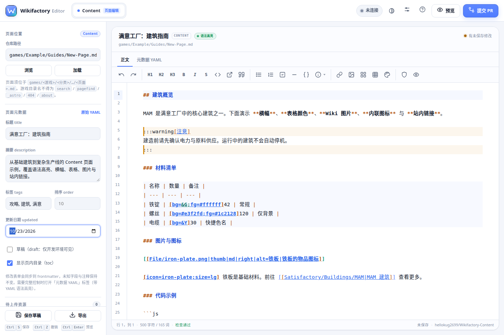
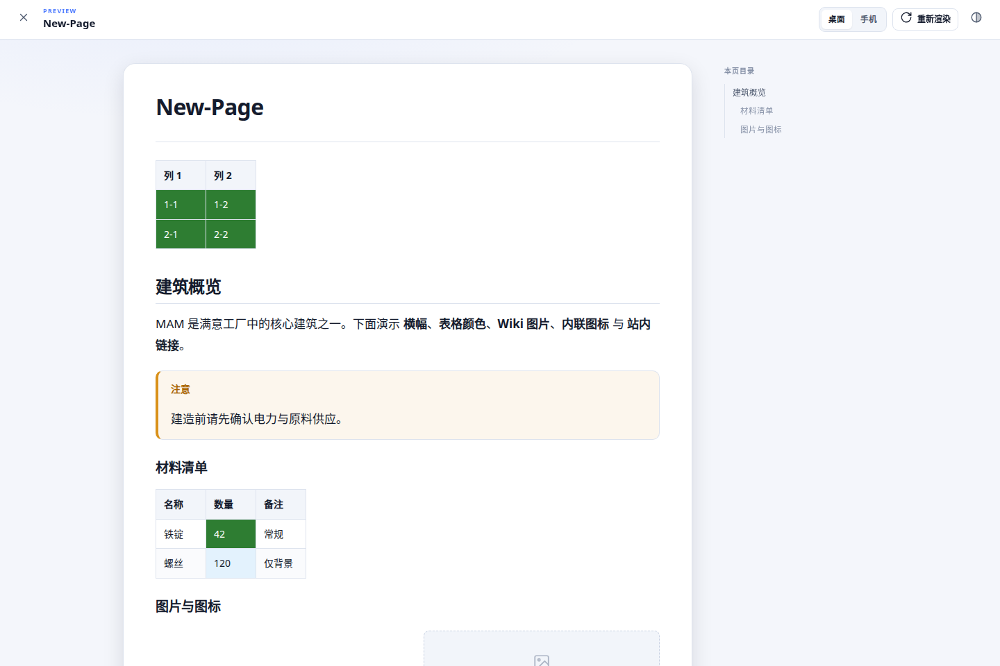
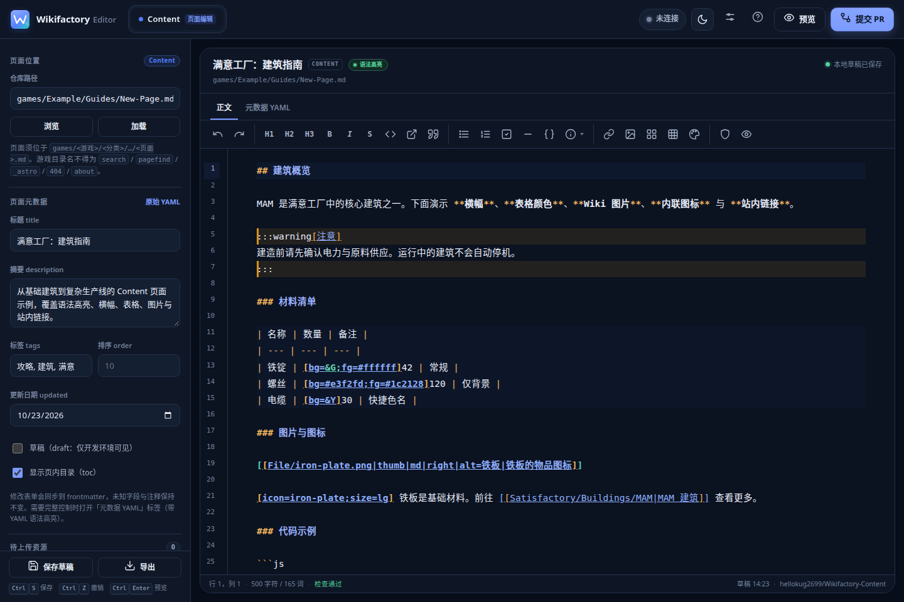
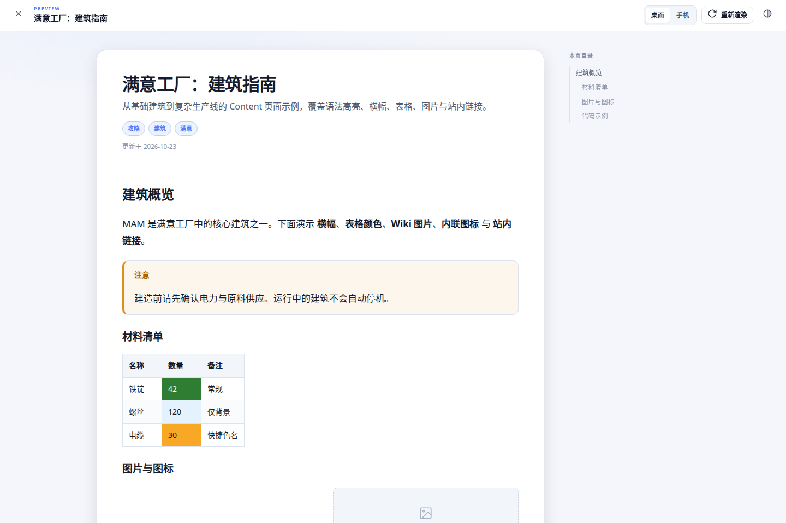
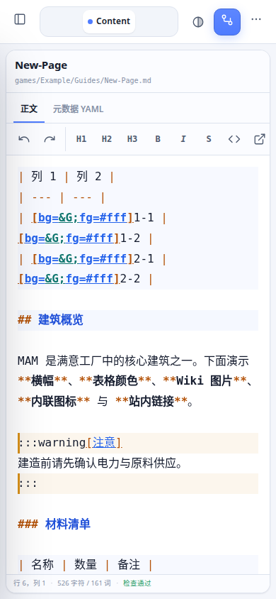
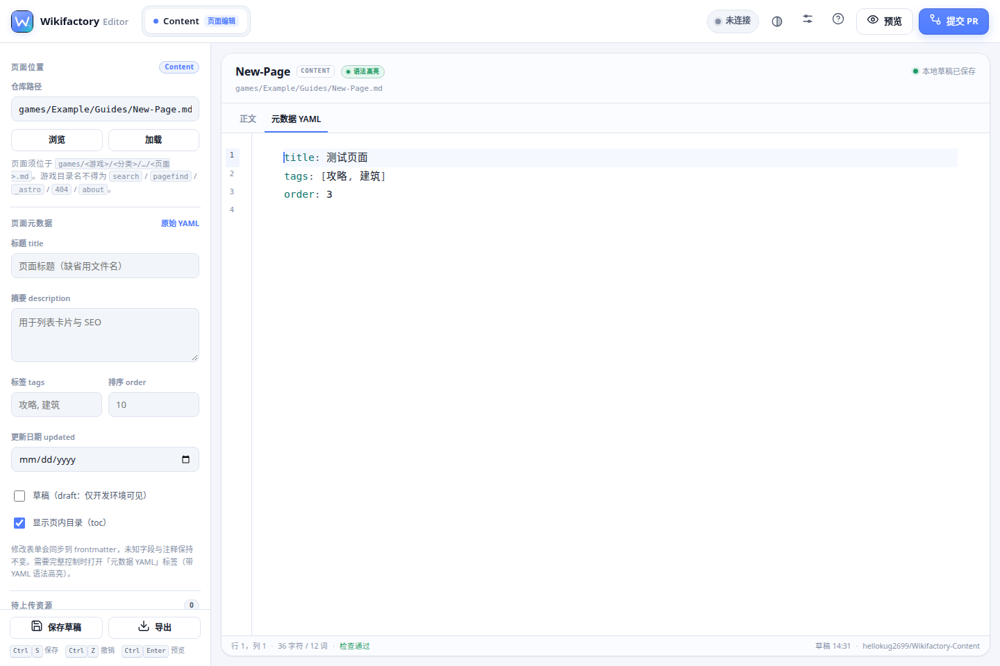
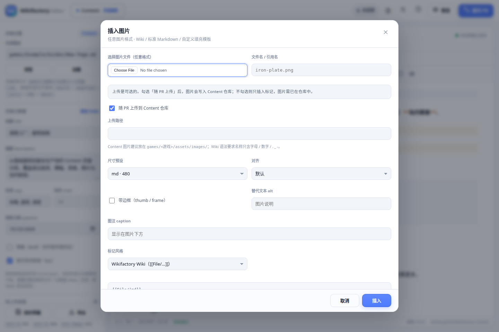
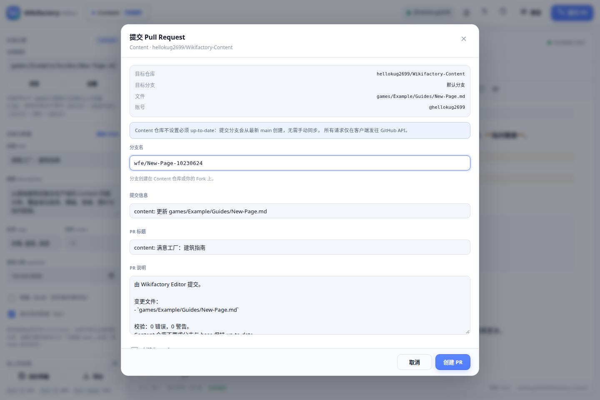

# Wikifactory Editor

面向 [Wikifactory](https://wikifactory.top) **Content 仓库**贡献者的跨平台编辑器。它在编辑器中提供真正的语法高亮、Wiki 语法工具、frontmatter 表单、表格/图片生成器与按需预览，并通过**纯客户端** GitHub API 提交 PR。

> **从 1.1.0 起，编辑器仅支持 `Wikifactory-Content`。** Core / Alias 仓库已从界面、状态与设置中移除；网络层也会拒绝任何其他仓库名的读写请求。**不提供 1.0.0 Release**。仓库 git 引用已重建，当前历史只包含 1.1.x；1.0.0 产物不在当前分支、标签或 Release 中。



## v1.1.7 质量更新

- **新建游戏 / 文件夹**：侧栏「页面位置」新增「新建游戏」按钮。填写游戏目录、分类、首个页面（可选标题）后会生成 `games/<游戏>/<分类>/<页面>.md`；文件夹会随该页面在 PR 中自动创建（Git 不保存空目录）。保留路径（`search` / `pagefind` / `_astro` / `404` / `about`）与非法名称会被拒绝。
- **修复退出行为切换不生效**：设置中的「退出行为」现在**选择后立即持久化**，无需再点「保存设置」；此前若选好默认值又直接关闭设置窗口，退出时仍沿用旧行为。提示窗口也会显示当前默认选项。
- **启动时询问是否恢复**：不再静默打开上次页面。检测到草稿时弹出「恢复上次编辑的页面？」，显示路径 / 标题 / 草稿时间 / 字数，可选择「恢复草稿」或「新建空白页」（清空草稿并回到默认路径）。启动检查更新会等该窗口关闭后再执行，不会抢占弹窗。
- 版本号：**1.1.7**（Android versionCode 9）。

## v1.1.6 质量更新

- **token 默认不保存**：「记住 token」默认关闭，token 只留在内存；需要自动恢复时由用户显式勾选（仍为加密存储）。
- **token 权限预检**：设置中的「测试连接」会读取经典 token 的 `x-oauth-scopes`，并结合仓库 `permissions.push` 与 Fork 状态，明确显示「写权限 / 只读 / 无法确认」。只读时直接提示无法提交 PR 及需要补充的权限。
- **首次提交前确认**：第一次提交 PR 前弹出权限确认窗口（账号、权限头、上游写权限、Fork 状态、所需权限），确认后不再重复；只读 token 会被拦下。
- **预览图片按需加载**：仓库已有图片不再只是占位块——占位块显示文件名与 alt，点击后才从 `raw.githubusercontent.com` 请求该图片；加载失败会明确提示，便于校对引用。
- **分支名冲突一键建议**：冲突窗口预填「内容页-日期-短哈希」建议名，并提供「换一个建议」；可直接采纳后重试。
- **行号栏可配置**：新增「行号栏：自动（移动端隐藏）/ 始终显示 / 始终隐藏」，底部状态栏始终显示「行 当前/总行数，列」。
- 版本号：**1.1.6**（Android versionCode 8）。

## v1.1.5 质量更新

- **隐藏 Android 状态栏**：设置页新增「隐藏 Android 系统状态栏（沉浸显示）」，仅 Android 应用可见；使用 `WindowInsetsController`（API 30+）或全屏标志（API 26–29）隐藏状态栏，滑动顶部可临时呼出。设置会持久化并在每次启动时恢复。
- **修复移动端「退出应用」无效**：Android WebView 也加载了 Neutralino 兼容脚本，`Neutralino.app.exit` 抢先执行但并无原生进程可退。现在优先调用 Android 桥接 `exitApp`（`finishAndRemoveTask` + `finishAffinity`），桌面端仍走 Neutralino，纯浏览器环境会明确提示「无法自动关闭窗口」，不再静默无反应。
- 版本号：**1.1.5**（Android versionCode 7）。

## v1.1.4 功能修复

- **资源目录按类型区分**：正文大图上传到 `games/<游戏>/assets/images/`，`[icon=…]` 内联图标上传到 `games/<游戏>/assets/icons/`。图标对话框新增文件上传与路径校验，不再出现"图标建议放 images"的误导。
- **图标存在性校验**：插入图标时先读取 Content 仓库文件树，确认 `assets/icons/<名称>.<ext>` 是否存在；缺失会阻断插入并提示应先上传。待上传的图标计入本次 PR，不会误报。
- **本地对齐内容门禁**：新增与 `scripts/validate-content.mjs` 同构的检查——路径层级、frontmatter 类型（含 `null`、ISO 日期、字符串数组元素）、`[icon=]` 文件存在性、重复 URL（`.md` / `.mdx`）与大小写冲突；提交 PR 前会强制刷新仓库文件树重新校验，问题在本地暴露而不是等 CI。
- 校验失败时仍会展示具体文件与行号（如 `games/<游戏>/assets/icons/xxx.svg`），可直接跳到对应行修改。
- 版本号：**1.1.4**（Android versionCode 6）。

## v1.1.3 功能更新

- **启动检查更新**：每次启动通过 GitHub API 读取编辑器仓库的最新 Release，仅提示版本与说明，**不自动下载**；设置页可关闭，也可以在提示窗口中勾选「不再在启动时检查更新」。
- **CONTRIBUTING.md 联动**：帮助、设置与移动端菜单新增「Content 使用须知」，直接读取 `Wikifactory-Content/CONTRIBUTING.md` 并在应用内渲染（相对链接自动转为 GitHub 地址）；读取失败时给出 GitHub 直达链接。
- **退出提示**：退出时若本次会话有修改，提示「保存并退出 / 不保存退出 / 取消」；保存后下次启动恢复，不保存则回到进入程序时的内容。可在设置 →「退出行为」选择「每次询问 / 总是保存 / 不保存直接退出」，提示窗口内也会说明该入口。
- Android 返回键同样会走退出确认；桌面版与网页版在直接关闭窗口时由 `beforeunload` 按同一设置处理。
- 版本号：**1.1.3**（Android versionCode 5）。
- 注意：本次 APK 由新的 Android debug 密钥签名，指纹与 1.1.2 不同；若覆盖安装失败，请先卸载旧版再安装。

## v1.1.2 功能修复

- **允许粘贴**：token 输入框仍禁止复制 / 剪切 / 拖拽，但支持 `Ctrl/⌘+V`、右键菜单与移动端长按粘贴（1.1.1 一并屏蔽了右键菜单，导致部分设备无法粘贴）。
- **记住 token**：新增「记住 token」选项（1.1.6 起默认关闭），token 加密保存在本机，下次启动自动恢复并验证，无需每次重新填写。
- **加密存储，而非明文**：token 必须先恢复才能使用，单向哈希无法满足自动登录，因此采用可逆加密：
  - Android：AES-GCM 密钥生成在 **Android Keystore** 内，密钥不可导出；磁盘上只有密文。
  - 网页 / Windows：WebCrypto **AES-256-GCM**，密钥由安装标识与设备特征经 PBKDF2（21 万次）派生，localStorage 中只有密文与随机 IV。
  - 关闭「记住 token」后仍为仅内存模式；旧版本的明文 token 会在启动时被清除。
- 版本号：**1.1.2**（Android versionCode 4）。

## v1.1.1 安全更新

- **token 不落盘**：只保存在当前运行内存，不写入 localStorage / 文件；关闭应用即失效。旧版本遗留的本地 token 会在启动时被清除。
- **禁止显示与复制**：token 输入框保持 password，移除「显示」按钮，并阻止复制、剪切、右键菜单与拖拽。
- **完整 token 指南**：设置页新增从创建 token 到测试连接的完整步骤，并明确说明公开仓库不等于可推送，绝大多数贡献者必须通过 Fork 提交。
- **分支名冲突处理**：编辑器不再自动追加后缀；若分支名被其他人占用，会弹出错误窗口要求更换，并保留已填写的提交信息。
- **自动删除已合并分支**：新增 GitHub Actions workflow，合并后删除本仓库中的 head 分支；Fork 分支需贡献者在自己的 Fork 中删除。
- 版本号：**1.1.1**（Android versionCode 3）。

## 下载（v1.1.7）

| 平台 | 产物 | 说明 |
| --- | --- | --- |
| Windows | [Wikifactory-Editor-v1.1.7-windows-x64.exe](https://github.com/hellokug2699/Wikifactory-Editor/releases/download/v1.1.7/Wikifactory-Editor-v1.1.7-windows-x64.exe) | 免安装单文件，资源已内嵌，约 3.3 MB；Windows 10/11 需要 WebView2 Runtime（通常已内置） |
| Android | [Wikifactory-Editor-v1.1.7-android.apk](https://github.com/hellokug2699/Wikifactory-Editor/releases/download/v1.1.7/Wikifactory-Editor-v1.1.7-android.apk) | debug 签名，可直接安装；Android 8.0+（minSdk 26） |
| 网页版 | [Wikifactory-Editor-v1.1.7-web.zip](https://github.com/hellokug2699/Wikifactory-Editor/releases/download/v1.1.7/Wikifactory-Editor-v1.1.7-web.zip) | 解压后运行 `node serve.mjs`，打开 `http://localhost:8090` |

也可以从仓库的 [`dist/`](dist/) 目录下载同名文件。

> APK 使用 Android debug 密钥签名，**不是**应用商店发布签名。若要长期分发并支持覆盖升级，请用自己的 release keystore 重新构建。
>
> exe 未做代码签名；首次运行若被 SmartScreen 拦截，选择「更多信息 → 仍要运行」即可。

### 校验和

见 [dist/SHA256SUMS.txt](dist/SHA256SUMS.txt)。

```
7a52f23247bd730d2bcccac1965fd0ba38d7165b7a6bcaa48930f3016163324a  Wikifactory-Editor-v1.1.7-android.apk
9182d62857345949a61e9887c298127225b1f10acce908a7405ee74c391bc014  Wikifactory-Editor-v1.1.7-windows-x64.exe
8081c190a4fbc82561951fe2ae5ba4411f0c4c01502508f84f064bc068d187eb  Wikifactory-Editor-v1.1.7-web.zip
```

## 功能

### 有效语法高亮（CodeMirror 6）

- 使用本地打包的 **CodeMirror 6**，不是透明 textarea 叠加层：真实编辑器状态、行号、活动行、括号匹配、选区与撤销栈。
- Markdown / GFM：标题、粗体、斜体、删除线、链接、列表、引用、代码、分隔线等使用主题化颜色。
- Wiki 标记额外高亮：
  - `[[File/…]]` 正文图片
  - `[[页面|显示文字]]` 站内链接
  - `[icon=…]` 内联图标
  - `:::warning[标题] … :::` 横幅（整行底色 + 左边框）
  - Markdown 表格行
  - `[bg=…;fg=…]` 表格单元格颜色标记
- 「元数据 YAML」标签使用 **YAML 语法高亮**。
- 围栏代码块按语言高亮：JS/TS、JSON、CSS、HTML、YAML。
- 配色同时适配亮色 / 暗色主题。



### Content 页面编辑

- 页面路径校验：`games/<游戏>/<分类>/…/<页面>.md`；拦截保留路径、非法字符、扩展名大小写等问题。
- frontmatter 表单：`title` / `description` / `tags` / `order` / `draft` / `updated` / `toc`，保留未知字段与注释；也可直接编辑原始 YAML。
- 一键格式：粗体插入 `****` 并把光标放在中间；斜体、删除线、行内代码同理；支持标题、引用、列表、任务列表、代码块、标准 Markdown 链接。
- 表格生成器：任意数据行数 × 列数（1–50 × 1–12）、表头、对齐、紧凑格式、**自定义单元格填充模板**（`{r}` / `{c}` / `{r0}` / `{c0}`）与高级源码模板。
- 图片插入：任意图片格式；可选 Wiki `[[File/…]]`、标准 Markdown `` 或自定义模板；可随 PR 上传到 `games/<游戏>/assets/images/`。
- 图标插入：`[icon=…]` 从 `games/<游戏>/assets/icons/` 读取；对话框会检查图标文件是否存在，并可把新图标随 PR 上传到同一目录。
- 横幅、图标、表格颜色、站内链接都有对应插入对话框。
- 本地草稿自动保存；`Ctrl+S` 立即保存；`Ctrl+Z` / `Ctrl+Shift+Z` 撤销重做；支持导出当前文件。

### 按需预览（非实时）

预览按钮或 `Ctrl+Enter` 生成快照；支持桌面 / 手机宽度、页内目录、亮暗主题、横幅、表格颜色、Wiki 图片、图标与站内链接。本次会话上传的图片可直接预览；仓库已有图片显示文件名与 alt 占位，点击后才按需加载（不预取）。

### GitHub PR（纯客户端）

- token **默认只保留在内存**；勾选「记住 token」后加密保存在本机（Android Keystore / 其他平台 AES-256-GCM），启动时自动恢复并验证。所有请求直接发往 `https://api.github.com`。
- 目标仓库**硬编码**为 `hellokug2699/Wikifactory-Content`；设置中没有仓库输入框，网络层也会拒绝其他仓库名。
- 有写权限时直接从最新 base 创建临时分支并提交；没有写权限时自动 Fork → 同步 Fork → 向 Content 仓库发起 PR。
- 一次 PR 可同时提交正文与多张图片；支持 Draft PR、自定义分支名 / 提交信息 / PR 标题与说明。
- **分支名由用户保留**：编辑器不会自动追加后缀；若分支名被占用，冲突窗口会给出「内容页-日期-短哈希」建议名并支持一键更换。
- **提交前本地门禁**：进入 PR 前会刷新 `Wikifactory-Content` 的文件树，执行路径层级、frontmatter 类型、`[icon=]` 图标存在性、重复 URL / 大小写冲突检查；有错误时阻断提交，并给出具体文件与行号。
- **Content 仓库不要求分支 up-to-date**：编辑器不检查也不阻塞；每次从最新 base 创建分支。
- 成功后显示 PR 链接，可复制链接。

### 自动删除已合并分支

仓库新增 [.github/workflows/delete-merged-branches.yml](.github/workflows/delete-merged-branches.yml)：PR 合并后自动删除**本仓库内**的 head 分支（`main` / `master` / `develop` 除外）。

> Fork PR 的 head 分支位于贡献者自己的仓库，上游 `GITHUB_TOKEN` 无权删除；贡献者可在自己的 Fork 设置中开启 “Automatically delete head branches”，或在合并后手动删除。

### 移动端

- 侧栏抽屉、底部操作面板、可横向滚动的格式栏。
- CodeMirror 编辑区字号 ≥ 16px、行高 1.8；行号栏可设为自动 / 显示 / 隐藏，移动端默认隐藏，底部始终显示「行 当前/总行数」。
- 触控目标优化；宽表在预览中横向滚动；已在 320 / 360 / 390 宽度实测无页面级横向溢出。

## 截图

| 亮色主界面 | 暗色主界面 |
| --- | --- |
|  |  |

| 预览 | 移动端（语法高亮） |
| --- | --- |
|  |  |

| YAML 元数据高亮 | 图片插入 |
| --- | --- |
|  |  |

| 提交 PR |
| --- |
|  |

更多截图见 [`docs/screenshots/`](docs/screenshots/)。

## 快速使用

1. 打开应用，点击右上角「未连接」或齿轮 → 填写 GitHub token。
2. 在左侧填写 Content 页面路径（例如 `games/Satisfactory/Buildings/MAM.md`），点「浏览」从仓库选择文件，或点「加载」按路径读取。
3. 在左侧填写元数据，在编辑区写 Markdown；用工具栏插入横幅、表格、图片、图标、站内链接。
4. 点「预览」检查最终页面。
5. 点「提交 PR」，确认分支名 / 提交信息 / PR 标题，创建 PR。

### Token 获取步骤（贡献者必读）

1. 打开 [GitHub → Settings → Developer settings → Personal access tokens (classic)](https://github.com/settings/tokens/new)。
2. Note 填 `Wikifactory Editor`，Expiration 选择合适期限。
3. 勾选 `public_repo`（公开仓库读写）。这是推荐方式。
4. 点击 Generate token，复制一次并粘贴到编辑器设置中。
5. 保存设置并点击「测试连接」，确认显示你的 `@用户名`。

> **公开仓库 ≠ 可以直接推送。** 绝大多数贡献者没有 `Wikifactory-Content` 的写权限；编辑器会自动先 Fork 到你的账户，再把分支推送到你的 Fork，并向 `hellokug2699/Wikifactory-Content` 发起 PR。只有维护者才可能直接在上游建分支。
>
> 若使用 Fine-grained token，需要对你 Fork 的 Content 仓库拥有 Contents / Pull requests 读写权限；若无法创建 Fork，请改用经典 token 的 `public_repo`。

### Token 权限

| 仓库 | 经典 token | 细粒度 token |
| --- | --- | --- |
| `Wikifactory-Content`（公开） | `public_repo`（提交 PR）/ 匿名读取也可 | 目标仓库的 Contents: Read and write、Pull requests: Read and write |

> 没有写权限时会自动走 Fork；Fork 由 GitHub 账户完成，公开仓库通常只需要 `public_repo`。
> token 默认只保留在内存；勾选「记住 token」后加密保存在本机（Android Keystore / 其他平台 AES-256-GCM），启动时自动恢复。输入框不提供「显示」按钮，并阻止复制 / 剪切 / 拖拽，但**允许粘贴**。应用没有后端，不会把 token 发往 GitHub 以外的地址。

## 快捷键

| 快捷键 | 功能 |
| --- | --- |
| `Ctrl/Cmd + S` | 保存本地草稿 |
| `Ctrl/Cmd + Z` | 撤销 |
| `Ctrl/Cmd + Shift + Z` 或 `Ctrl + Y` | 重做 |
| `Ctrl/Cmd + B` | 粗体（插入 `****`，光标居中） |
| `Ctrl/Cmd + Enter` | 生成预览快照 |
| `Esc` | 关闭预览 / 弹窗 / 移动端侧栏 |

## 支持的 Wiki 语法

```md
---
title: 页面标题
description: 摘要
tags: [攻略, 建筑]
order: 10
updated: 2026-10-13
toc: true
---

:::warning[注意]
横幅正文，支持 **加粗**。
:::

[[File/iron-plate.png|thumb|md|right|alt=铁板|铁板的物品图标]]
[[File/iron-plate.png;thumb;md]]          ← 表格内用 ; 分隔选项

[icon=iron-plate;size=lg;bg=&G] 铁板

[[Satisfactory/Buildings/MAM|MAM 建筑]]

| 名称 | 数量 |
| --- | --- |
| 铁锭 | [bg=&G;fg=#ffffff]42 |
```

- 图片目录：`games/<游戏>/assets/images/`；图标目录：`games/<游戏>/assets/icons/`。
- 表格颜色支持快捷色名 `&R` `&O` `&Y` `&G` `&B` `&P` `&K`（以及 `&red` 等长名）。
- 图片尺寸预设：`sm` / `md` / `lg` / `full`；对齐：`left` / `center` / `right`。
- 正文图片请使用 `File/` 而不是 `File:`（避免与 `:::warning` 指令冲突）。

## 目录结构

```
app/                 静态 Web 应用（无框架、离线可用）
  assets/css/        界面与 CodeMirror 主题样式
  assets/js/         编辑器适配、Wiki 预览、校验、GitHub 客户端
  assets/vendor/     CodeMirror 6 bundle、marked、DOMPurify、Neutralino 客户端
desktop/             Neutralinojs 桌面壳配置
android/             Android WebView 壳（Gradle）
scripts/             构建、vendor bundle 与自测脚本
docs/screenshots/    README 截图
dist/                交付产物（exe / apk / web zip）
```

## 构建

环境要求：

- Node.js ≥ 20、npm
- `curl`、`unzip`、`zip`（桌面 / 网页构建）
- Android：JDK **21**、Android SDK Platform 35、Build-Tools 35.0.0、Gradle 8.9+
  - AGP 8.7 不支持 JDK 25；请设置 `JAVA_HOME` 指向 JDK 21。
  - 设置 `ANDROID_HOME` / `ANDROID_SDK_ROOT`，或在脚本可访问 `/opt/android-sdk`。

```bash
npm install
npm run build:vendor    # 重新打包 CodeMirror 6（依赖变更后执行）
npm test                # 内容规则 / frontmatter / Wiki 语法 / GitHub PR mock
npm run build:web       # dist/Wikifactory-Editor-v1.1.7-web.zip
npm run build:desktop   # 下载 Neutralinojs 6.10.0 并生成 Windows 单文件 exe
npm run build:android   # 生成 debug-signed APK（需 Android SDK）
```

桌面构建会在 `desktop/bin/` 缓存 Neutralinojs 二进制（已忽略），并通过 `neu build --release --embed-resources` 把全部资源嵌入 exe。

Android 壳通过 `WebViewAssetLoader` 以 `https://appassets.androidplatform.net` 加载本地静态文件，因此 `localStorage`、`fetch` 与 CORS 行为与普通浏览器一致；仅 `api.github.com` 会收到网络请求。

## 已知限制

- 预览是按需快照，不是实时渲染；仓库中已有的图片显示文件名 / alt，点击后才按需加载（本次会话上传的图片可直接预览）。
- Android 产物为 debug 签名；没有接入 Play Store / 自动更新。
- Windows exe 依赖 WebView2 Runtime（Windows 10/11 通常自带）。
- 编辑器仅访问 Content 仓库；如果未来需要恢复 Core/Alias，应作为独立应用或明确的新版本决策，而不是在当前版本中放开。
- 若 GitHub 的 Content 仓库启用了 “Require branches to be up to date” 分支保护，仍需在仓库设置中关闭；编辑器侧本身不做该限制。

## 安全说明

- token 默认加密保存在本机：Android 使用 Android Keystore（密钥不可导出），网页 / Windows 使用 AES-256-GCM 设备绑定密钥，存储中只有密文与随机 IV，不存在明文 token。
- 关闭「记住 token」时 token 只留在内存；离开共享设备前请使用设置中的「清除 token」。
- token 输入框不提供显示按钮，并阻止复制、剪切与拖拽；粘贴可用，但请勿自行截图或粘贴到其他位置。
- 注意：网页 / Windows 的加密密钥由本机可见信息派生，能运行调试工具的攻击者仍可能解密，属于提高门槛而非硬件隔离；Android Keystore 提供真正的不可导出密钥。
- 网络层只允许 `Wikifactory-Content`；Core / Alias 仓库名会被直接拒绝。
- 启动检查更新与读取 CONTRIBUTING.md 只访问 `api.github.com`，不会发送 token 到编辑器仓库；更新只提示、不下载。
- 建议为编辑器单独创建最小权限 token，并定期在 GitHub 设置中撤销。
- 公开仓库内不要提交任何 token、密钥或个人隐私信息。

## 许可

[MIT](LICENSE)
